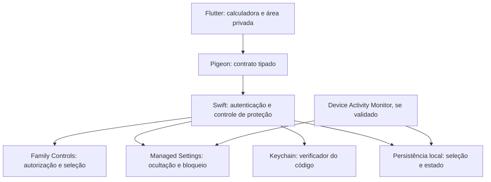

# Plano de desenvolvimento da calculadora com proteção de aplicativos bancários no iOS

Data de referência: 1 de novembro de 2026.

Distribuição escolhida: **AltStore PAL**, com notarização da Apple. A implementação e o roteiro operacional estão em [IMPLEMENTACAO_E_PUBLICACAO.md](IMPLEMENTACAO_E_PUBLICACAO.md). A seleção e o bloqueio nativos foram escritos, mas a compilação Swift, o comportamento físico e a publicação ainda dependem da conta e do ambiente de iOS.

Nome público do aplicativo: **Calculadora**. A tela inicial e o ícone devem apresentar uma calculadora funcional com identidade própria. A área privada é acessível pelo número configurado seguido de `=`.

Desenvolver um aplicativo Flutter com calculadora funcional e uma área privada acessível por código numérico configurável. Essa área permitirá selecionar aplicativos bancários e controlar sua ocultação e bloqueio no próprio iPhone. A ausência de notificações dos aplicativos protegidos será um requisito de aceitação, com validação em aparelhos reais antes de anunciar a funcionalidade.

A Apple documenta uma API pública que oculta aplicativos e impede sua abertura: `ManagedSettingsStore.application.blockedApplications`. Isso oferece um caminho técnico para a ideia. Entretanto, a documentação dessa propriedade não especifica todas as superfícies de pesquisa nem garante o comportamento das notificações. Esses dois pontos precisam ser demonstrados na prova de conceito. [Documentação da Apple sobre blockedApplications](https://developer.apple.com/documentation/managedsettings/applicationsettings/blockedapplications-swift.property).

O código controlará a liberação realizada pelo aplicativo. Ele não poderá ser o único caminho global para recuperar acesso aos bancos: com autorização individual do Screen Time, o usuário pode revogar a autorização nas configurações e pode remover o aplicativo. Isso limita a proteção quando alguém conhece ou exige o código de desbloqueio do iPhone. O produto deve ser apresentado como uma camada adicional de privacidade e restrição de acesso, sem promessa de impedir um sequestro, a coação ou uma transação bancária. [Autorização individual e suas limitações](https://developer.apple.com/videos/play/wwdc2022/110336/).

## Escopo e premissas

- Plataforma inicial: iPhone pessoal, sem jailbreak e sem gerenciamento corporativo obrigatório.
- Interface e lógica da calculadora em Flutter e Dart; integração com o sistema em Swift.
- iOS 16 como ponto de partida técnico para autorização individual. A menor versão comercialmente suportada será definida pelos testes e pelos requisitos vigentes de Flutter e Xcode.
- Seleção explícita dos aplicativos pelo dono do aparelho.
- Funcionamento local e offline após a configuração; o MVP não exige cadastro nem servidor.
- Uso apenas de APIs públicas, com autorização do usuário e capacidade Family Controls aprovada para distribuição.
- O requisito de notificações abrange os apps selecionados nesse iPhone. SMS, e-mails, aplicativos do banco em outros dispositivos e outros canais exigem medidas próprias.

### Viabilidade dos requisitos

| Requisito | Situação | Decisão de desenvolvimento |
| --- | --- | --- |
| Calculadora funcional com aparência discreta | Viável em Flutter | Criar identidade própria e operações reais. |
| Entrada de número configurável | Viável | Validar uma sequência de dígitos, preservando zeros iniciais. |
| Ocultar e impedir abertura de apps | Há API pública documentada | Usar `application.blockedApplications` e provar o resultado com autorização individual. |
| Não aparecer na lista da Biblioteca de Apps nem na pesquisa | Precisa de validação específica | Testar Biblioteca, Spotlight e sugestões por versão do iOS. |
| Não emitir nem mostrar notificações enquanto protegido | Precisa de validação específica | Tornar bloqueante para a aceitação do escopo completo. |
| Liberar os apps pela calculadora usando o código | Viável, condicionado às permissões | Retirar somente as restrições aplicadas por este aplicativo. |
| Exigir esse código como único meio de acesso em todo o iOS | Não garantido na autorização individual | Registrar os caminhos de revogação e remoção; não anunciar exclusividade. |
| Impedir descoberta em qualquer tela do sistema | Não garantido | Verificar e documentar vestígios em Ajustes, armazenamento, App Store e Tempo de Uso. |

`application.blockedApplications` e `shield.applications` são mecanismos diferentes. O primeiro é o candidato principal para ocultação; o segundo aplica uma tela de restrição e, sozinho, não satisfaz a exigência de desaparecer da lista e da pesquisa. A Apple documenta limite de 50 aplicativos para a propriedade de bloqueio. O MVP deve selecionar apps individuais e respeitar esse limite. [Managed Settings](https://developer.apple.com/documentation/managedsettings).

## Primeira etapa e decisões de continuidade

Executar uma prova de conceito pequena em Swift antes da implementação completa. Ela verificará o mecanismo do iOS que sustenta o produto e depois será integrada ao Flutter.

### Prova de conceito em aparelho real

1. Configurar um App ID com Family Controls e solicitar autorização `.individual`.
2. Abrir o seletor nativo `FamilyActivityPicker` e selecionar aplicativos de teste.
3. Converter os tokens selecionados em objetos `Application` e aplicar `application.blockedApplications` em um store próprio.
4. Verificar ocultação, impedimento de abertura, persistência e remoção das restrições.
5. Repetir com pelo menos dois aplicativos bancários, sem consultar dados de contas nem executar transações.
6. Usar um app auxiliar de teste para produzir notificações locais e push controladas. Complementar com notificações bancárias reais quando for possível obter evidência sem operação financeira.
7. Testar com o app controlador em segundo plano, encerrado, após reinício e após alterações de autorização.

Guardar uma matriz com modelo do aparelho, versão exata do iOS, assinatura da build, app selecionado, passos, resultado e evidência sem dados bancários pessoais.

### Critérios para avançar

- A ocultação deve funcionar com autorização individual em todas as versões e aparelhos declarados como suportados.
- Os apps selecionados não podem aparecer na Biblioteca de Apps ou na pesquisa durante o bloqueio, conforme a matriz de testes.
- Não pode haver banners, sons, badges ou notificações bancárias visíveis nas superfícies cobertas pelo produto enquanto o bloqueio estiver ativo.
- O número correto deve permitir a liberação pelo aplicativo; entradas incorretas não podem alterar as restrições.
- Os caminhos para revogar permissões ou remover o controlador precisam estar reproduzidos e documentados.
- O uso pretendido precisa ser elegível para Family Controls e para distribuição.

Se a ocultação ou as notificações falharem, a versão não satisfaz o escopo completo pedido. As opções serão restringir as versões suportadas, investigar uma solução pública comprovável ou propor uma alteração de escopo expressa. Orientar configuração manual do iOS pode compor uma alternativa, mas não equivale a ocultação e silenciamento automáticos comandados pelo código.

A permissão de distribuição da Family Controls depende da Apple e também deve ser solicitada para cada extensão que a utilizar. O contrato limita a finalidade do framework, incluindo gerenciamento individual do próprio dispositivo. O enquadramento deste caso de privacidade e coação precisa ser confirmado com uma descrição fiel da funcionalidade. [Solicitação da capacidade](https://developer.apple.com/documentation/familycontrols/requesting-the-family-controls-entitlement) e [contrato do programa Apple Developer](https://developer.apple.com/support/terms/apple-developer-program-license-agreement/).

## Fluxo de uso

### Configuração inicial

1. Apresentar a finalidade, as permissões necessárias e os limites relevantes da proteção.
2. Cadastrar e confirmar um código de 8 a 12 dígitos, diferente do código do iPhone. Essa faixa é uma proposta inicial de produto.
3. Autorizar Family Controls pela interface oficial do iOS.
4. Selecionar os aplicativos bancários no seletor nativo.
5. Aplicar as restrições e conduzir uma verificação assistida de ocultação e notificações.
6. Voltar à calculadora com a sessão privada fechada.

A primeira configuração deve ocorrer em situação segura. O app não deverá solicitar permissões ou disparar telas inesperadas como parte de uma reação emergencial.

### Uso cotidiano

- A abertura normal mostra uma calculadora funcional, com operações básicas, percentuais, limpeza e separador decimal adequado ao idioma.
- Uma sequência composta somente por dígitos, seguida de `=`, será candidata ao código. Resultados de contas nunca serão interpretados como senha.
- Entrada incorreta mantém o comportamento de calculadora e não revela a área privada.
- Entrada correta abre a área privada. Uma ação explícita de “Liberar acesso” retira as restrições dos apps selecionados. Separar autenticação e liberação reduz desbloqueios acidentais durante contas comuns.
- “Proteger agora” reaplica as restrições e fecha a área privada.
- Ao perder o foco, a área privada volta a exigir o código e seu conteúdo é substituído por uma tela neutra na prévia do alternador de apps.

Fechar a área privada e bloquear os bancos são ações distintas. Ao abrir um banco, a calculadora vai para segundo plano; bloquear todos os bancos nesse instante impediria o uso autorizado. O MVP deve oferecer bloqueio manual explícito e testar a possibilidade de janelas temporárias com mecanismo nativo. Temporizadores Dart não serão usados como garantia de rebloqueio com o app suspenso ou encerrado.

### Opção posterior para código de coação

Avaliar, após testes de usabilidade, um segundo código que mantenha os bancos bloqueados e apresente apenas um resultado de calculadora. Ele não deve apagar dados, produzir sons ou enviar avisos. Essa opção não elimina os caminhos de revogação do iOS e pode aumentar o risco se descoberta; sua inclusão depende de avaliação específica de uso sob coação.

## Requisitos do MVP

| ID | Requisito | Aceitação |
| --- | --- | --- |
| RF01 | Calculadora real e interface própria | Operações corretas, inclusive percentuais, divisão por zero e localização. |
| RF02 | Código numérico configurável | Cadastro duplo, comparação da entrada literal e alteração autenticada. |
| RF03 | Seleção nativa de aplicativos | Seleção persistida por tokens e restauração correta após reabrir. |
| RF04 | Proteger apps selecionados | Aplicar somente a seleção vigente e validar ocultação e bloqueio. |
| RF05 | Liberar pelo código | Autenticação correta seguida da ação explícita; código errado nunca libera. |
| RF06 | Ausência de notificações enquanto protegido | Aprovar a matriz de notificações, incluindo notificações já entregues. |
| RF07 | Bloqueio manual | “Proteger agora” aplica as restrições sem depender de conexão. |
| RF08 | Privacidade da área de controle | Sessão fechada ao perder foco; código e nomes não entram em logs ou histórico. |
| RF09 | Identificação de autorização perdida | Reconciliar ao abrir e retomar o app; não indicar proteção ativa sem autorização. |
| RF10 | Recuperação e encerramento do uso | Procedimentos definidos para código esquecido, troca de aparelho e remoção. |

A aplicação não consegue inspecionar todas as telas e notificações do sistema para confirmar automaticamente a invisibilidade. O status deve distinguir “restrição configurada” de “comportamento verificado nos testes”; não deve apresentar uma garantia de segurança física.

## Arquitetura em Flutter e Swift

Flutter permite integrar Swift por canais de plataforma; Pigeon pode gerar os contratos tipados dessa comunicação. A interface nativa do seletor será apresentada por SwiftUI a partir do controlador iOS. [Integração oficial do Flutter com código de plataforma](https://docs.flutter.dev/platform-integration/platform-channels).

### Componentes

| Componente | Responsabilidade |
| --- | --- |
| `calculator` em Dart | Entrada literal, cálculo e interface pública. |
| `private_area` em Dart | Configuração, seleção assistida e comandos de proteção. |
| `ios_protection` em Swift | Autorização, armazenamento dos tokens, aplicação e retirada de restrições. |
| `secret_verifier` em Swift | Verificar código, limitar tentativas e autorizar comandos sensíveis. |
| Store próprio de Managed Settings | Isolar as restrições deste app das de outros controladores. |
| Device Activity Monitor | Implementar eventual rebloqueio programado somente após validação. |
| App Group, quando houver extensão | Compartilhar seleção, estado e geração das operações com a extensão. |

O contrato nativo deve contemplar autorização, apresentação do seletor, quantidade selecionada, autenticação, bloqueio, liberação e consulta do estado. O código deve ser verificado no módulo nativo, que também controla a liberação; a ponte não deve oferecer um comando de desbloqueio incondicional.

Preferir tokens opacos de aplicativos e os rótulos oficiais do sistema. Não depender de varredura irrestrita dos aplicativos instalados nem da dedução de que toda uma categoria contém apenas bancos. [Seleção e privacidade em Family Controls](https://developer.apple.com/documentation/familycontrols).

### Estado e persistência

Separar estado de autorização, política desejada e sessão privada. Os estados principais da política serão `nao_configurado`, `protegido`, `liberado` e `protecao_indisponivel`.

- Usar o estado nativo como fonte de referência; a tela Flutter não determina sozinha a proteção.
- Manter a política de proteção persistida e reconciliá-la ao iniciar e retomar, desde que a autorização exista.
- Serializar alterações para evitar corrida entre o app e uma eventual extensão.
- Se houver janelas temporárias, persistir prazo e identificador da sessão para que um evento antigo não altere uma sessão nova.
- Não remover restrições como efeito de um erro de autenticação ou de leitura de configuração.
- Validar eventos de reinício, primeira autenticação do aparelho, mudança do relógio, reinstalação e atualização do iOS.

## Notificações e superfícies que precisam ser verificadas

O silenciamento deverá resultar do mecanismo de restrição do iOS, se demonstrado pela prova de conceito. `UNUserNotificationCenter` gerencia notificações do próprio app ou de suas extensões; não fornece à calculadora controle geral sobre as notificações dos bancos. Não projetar um interceptador nem presumir que será possível apagar notificações de terceiros. [API de notificações da Apple](https://developer.apple.com/documentation/usernotifications/unusernotificationcenter).

| Grupo | Casos obrigatórios |
| --- | --- |
| Descoberta principal | Tela inicial, Biblioteca de Apps, busca da Biblioteca, Spotlight e sugestões da Siri. |
| Abertura | Ícone antigo, atalhos, links externos, links universais, App Store e aplicativo bancário já aberto. |
| Notificações novas | Push e notificações locais; tela bloqueada, aparelho desbloqueado, banners, sons e badges. |
| Notificações anteriores | Central de Notificações antes de bloquear; persistência, desaparecimento e possibilidade de abrir o banco. |
| Transições | Notificação durante bloqueio e liberação; notificações atrasadas ou reapresentadas após liberar. |
| Recursos adicionais | Resumos, notificações sensíveis ao tempo, alertas críticos quando aplicáveis, widgets e atividades ao vivo. |
| Dispositivos conectados | Espelhamento no Apple Watch, CarPlay e outros dispositivos, quando incluídos na promessa do produto. |
| Vestígios | Ajustes, armazenamento, Tempo de Uso, histórico e tela de compras da App Store. |

Configuração manual para desativar notificações dos bancos poderá ser recomendada como precaução adicional. Ela exige ação do usuário, pode afetar alertas úteis e não substitui a validação do requisito automático.

## Segurança e uso sob coação

- Guardar um verificador derivado do código com salt e função de derivação de chave adequada; não guardar o número em texto puro.
- Proteger os segredos no Keychain, com política `ThisDeviceOnly` e sem sincronização. Validar separadamente a acessibilidade dos dados necessários às extensões após reinício.
- Aplicar comparação apropriada e limitação progressiva de tentativas no módulo nativo. Não bloquear as operações comuns da calculadora por causa de tentativas de código.
- Não registrar entradas da calculadora, código, nomes de bancos ou tokens em logs, analytics ou relatórios de falha.
- Não manter o código no histórico, na área de transferência ou em prévias recentes. Considerar exposição visual durante a digitação nos testes de usabilidade.
- Proteger a prévia do próprio aplicativo. Não prometer impedir capturas ou gravações de outras aplicações.
- Usar interface e ícone próprios de calculadora, sem se passar pela calculadora oficial da Apple.
- Evitar backend, anúncios e telemetria no MVP.
- Documentar a revogação da autorização e a remoção como caminhos fora do controle do código privado.
- Testar a possibilidade de acesso pelo site do banco e registrar que ocultar o app não bloqueia automaticamente todos os canais bancários.

O uso deve ser avaliado em simulações controladas de usabilidade, sem expor participantes a ameaças reais. O objetivo é reduzir descoberta casual e acesso imediato dentro dos limites do sistema.

### Recuperação

Definir antes do piloto como tratar código esquecido. Uma opção é emitir um segredo de recuperação local para guarda fora do aparelho, necessário para redefinir o código pelo aplicativo. A recuperação não deve mostrar o código anterior.

A redefinição pela aplicação não elimina os caminhos de remoção e revogação oferecidos pelo iOS. Troca de aparelho, restauração de backup e reinstalação exigirão nova verificação de autorização, seleção e proteção; não assumir que os tokens e a política permanecerão válidos.

## Plano de execução

Estimativa inicial de 7 a 10 semanas, com uma pessoa dedicada a Flutter, uma pessoa com experiência em iOS nativo e participação de QA e revisão de segurança. O prazo de análise de capacidades e publicação pela Apple é externo e não está incluído.

| Fase | Duração proposta | Entrega | Dependência |
| --- | --- | --- | --- |
| 0 Viabilidade | 1 a 2 semanas | PoC Swift, matriz inicial, limites do sistema e enquadramento da capacidade | Mac, iPhone real e conta de desenvolvimento. |
| 1 Produto e UX | 1 semana | Fluxos, calculadora, estados, recuperação e textos de permissão | Conclusões técnicas da fase 0. |
| 2 Implementação do MVP | 2 semanas | Flutter, ponte Swift, código, seleção e ocultação integrados | Ocultação validada. |
| 3 Persistência e proteção | 1 a 2 semanas | Tratamento de erros, tentativas, sessão privada e eventual rebloqueio nativo | MVP integrado e cenários de ciclo de vida. |
| 4 Validação | 1 a 2 semanas | Matriz completa em aparelhos reais e correção de falhas | Builds assinadas e dispositivos de teste. |
| 5 Piloto e distribuição | 1 semana | Piloto via distribuição autorizada, documentação e submissão | Capacidade de distribuição concedida e critérios de aceitação atendidos. |

### Backlog inicial

| ID | Prioridade | Trabalho |
| --- | --- | --- |
| DEV01 | P0 | Configurar assinatura e investigar elegibilidade de Family Controls. |
| DEV02 | P0 | Provar ocultação com `blockedApplications` e autorização individual. |
| DEV03 | P0 | Provar ausência de notificações novas e anteriores. |
| DEV04 | P0 | Reproduzir revogação, remoção e comportamento após reinício. |
| DEV05 | P1 | Especificar calculadora, código e transições da área privada. |
| DEV06 | P1 | Implementar calculadora e integração tipada com Swift. |
| DEV07 | P1 | Implementar Keychain, verificação e limitação de tentativas. |
| DEV08 | P1 | Implementar seleção, persistência e comandos de proteção. |
| DEV09 | P1 | Implementar privacidade da sessão e tratamento de autorização perdida. |
| DEV10 | P1 | Definir recuperação e demonstrar os procedimentos em aparelho real. |
| DEV11 | P1 | Executar matriz por versão suportada e revisar exposição de dados. |
| DEV12 | P2 | Investigar janelas temporárias com Device Activity e testar eventos atrasados. |
| DEV13 | P2 | Avaliar código de coação em testes específicos de usabilidade. |
| DEV14 | P1 | Preparar metadados, política de privacidade e instruções para revisão. |

## Testes e conclusão do desenvolvimento

### Testes automatizados

- Unitários Dart para operações, localização, entrada literal e impossibilidade de liberar por resultado de conta.
- Unitários Swift para verificação de código, tentativas, persistência e transições de política.
- Testes da ponte para autorização negada, erro nativo, retomada e chamadas sem autenticação.
- Integração do app e eventual extensão para concorrência e eventos de uma janela anterior.

Esses testes verificam a aplicação. A ocultação e o silenciamento reais precisam dos testes físicos da matriz; mocks e simuladores não comprovam o requisito do sistema.

### Critérios de entrega

1. Todas as combinações declaradas como suportadas passam na matriz de ocultação e notificações.
2. O código configurado é necessário para a liberação pela calculadora, e não existe comando nativo incondicional para liberar.
3. Os apps ficam acessíveis no período de liberação e voltam a ser restringidos após “Proteger agora”.
4. Não há exposição do código ou da seleção nos logs, histórico ou prévia do controlador.
5. Autorização negada ou revogada não produz indicação enganosa de proteção.
6. Reinício, atualização, recuperação e retirada da proteção têm procedimentos verificados.
7. O usuário recebe explicação objetiva dos caminhos do iOS que podem contornar a proteção.
8. A distribuição usa capacidades concedidas para o app e para suas extensões.

## Ambiente e publicação

O desenvolvimento Flutter e Swift ocorre no Windows. A compilação e a assinatura serão feitas no macOS do Codemagic; os testes físicos serão feitos no iPhone, inclusive conectado ao Windows para instalação da IPA de desenvolvimento. [Preparação do ambiente iOS no Flutter](https://docs.flutter.dev/platform-integration/ios/setup).

Para distribuição pelo AltStore PAL, preparar descrição verdadeira da calculadora e da área privada, política de privacidade e instruções para notarização. Usar Apple Developer Program, capacidades Family Controls aprovadas, perfis compatíveis e ADP notarizado. A finalidade será descrita ao usuário, à Apple e ao marketplace. [Distribuição PAL](https://faq.altstore.io/developers/distribute-with-altstore-pal).

O primeiro marco é a prova de conceito da fase 0. Somente seu resultado permite transformar os requisitos de ocultação e silêncio em uma promessa verificável para versões específicas do iOS.
